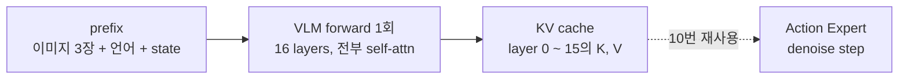

> 실습 목표 자체는 실제로 VLA의 코드를 뜯어 분석해보는 것이다. (lerobot → SmolVLA)
>
> - Inference
>   - VLM (이전시간)
>   - Action Expert (이번시간)
> - Training (다음시간)
{: .prompt-info }

<div class="notion-gap" style="--gap: 1"></div>

[SmolVLA: A vision-language-action model for affordable and efficient robotics](https://arxiv.org/html/2506.01844v1)

<div class="notion-gap" style="--gap: 1"></div>


VLA중에서 가장 흠… 저렴한 그리고 가벼운 VLA → SmolVLA를 운이 좋게 발견하였다. lerobot이라는 커뮤니티라고 해야할까? 곳에서 로봇의 학습을 중요시하고 저렴한 모델과 로봇, 그리고 데이터셋을 공개해주는 아주 착한 커뮤니티이다. 

지난시간에는 우리가 추론단계에서도 **VLM 즉 앞 쪽 부분**을 코드를 뜯어보면서 분석했었다.

오늘 today , jintian은 SmolVLA lerobot 코드 분석 두번째 시간에는 이제 **오른쪽 Action 루프**에 대해서 탐구를 진행해보자. 

<div class="notion-gap" style="--gap: 1"></div>

## Overall workflow

---

(지난시간 리마인더)

결국 우리가 받는 image, prompt , state → 를 가지고 원하는 관절값 액션을 뽑아내야한다. 여기서 대부분까지는 아니어도 다들 “아 우리가 pre-trained된 VLM을 가져다 쓰자”라고 이 VLA연구들이 시작되었다. 따라서, 사전학습된 VLM에 넣고, 그리고 얻어낸 16개 self attention layer마다의 Key, Value vector을 Cache에 저장해서 그대로 Action Expert의 self attention layer and cross attention layer에다가 넣어준다.


<div class="notion-gap" style="--gap: 1"></div>

핵심은 Action expert loop을 Denoising 이라고 칭한다. Diffusion model과 비슷하게 노이즈 → 우리가 원하는 액션으로 바꾸는 그렇게 학습된 모델이기 때문이다.

여기서 Query = \{action_token\} 이고 이제 Key, Value는 \{Image, Language, state, Action\}을 전부 포함하거나, Action은 제외되거나에 따라서 self attention, cross attention이 갈리는 것이다.

(사실 이렇게 말할 수 있는 것도 한바퀴를 분석을 진행하고 돌아왔기 때문이다… 맨처음에 저 루프를 볼때, 아니 뭐가 뭔지 잘 몰랐다… 일단 질문을 가지고 밑에 분석에 들어가보자)

> 정확히 우리가 로봇의 관절값을 뽑을때, Image, task, state를 참고를 할 것인데 어떻게 참고를 하도록 설계가 되어있는가??

<div class="notion-gap" style="--gap: 1"></div>

아 들어가기전에 나도 배우면서 알게된 용어정리를 한번하고가자. 

> - prefix : \{ Image, Language, State \} tokens → 192 + 48 + 1 = 241 tokens (960-dim)
> - suffix : \{ Action \} tokens → 50 tokens (720-dim, noisy action + time)
{: .prompt-info }

prefix 가 접두사, suffix가 접미사라는 것도 처음알았다. 이게 VLM에서 input으로 들어가는게 prefix 그 뒤에 denoising action expert model에 input으로 들어가는 것을 suffix라고 칭하는 것이다. 

(코드 주석에는 저 용어로 정리되어있고, 이 분야에서는 consensus하게 저 용어를 쓰는 것을 확인하였다)

<div class="notion-gap" style="--gap: 1"></div>

자 이제 들어가기전에, Flow Matching 개념 진짜 한번만 보고 가자

## 0. (Review) Flow matching

---

Action Expert가 하는 일은 한 줄로 요약하면,

> **"노이즈에서 액션으로 가는 속도장(velocity field)을 예측하는 것"**

Diffusion과 같은 생성 모델 계열이지만, 노이즈와 데이터 사이를 **직선 경로**로 잇고 그 경로 위의 속도를 배운다는 점이 다르다.

<div class="notion-gap" style="--gap: 1"></div>

#### <span color="red">“지난시간 Flow matching 블로그에서 굉장히 강조한 부분은 바로, <br>학습: 직선 경로 위의 속도를 배운다 는 것”</span>

SmolVLA(lerobot) 코드 기준으로 $t=1$ 이 노이즈, $t=0$ 이 실제 액션이다. 둘을 직선으로 섞은 점 $x\_t$ 를 만들고,

$$
x_t = t\,\epsilon + (1-t)\,a, \qquad \epsilon \sim \mathcal{N}(0, I)
$$

이 직선의 속도(시간 미분)를 정답으로 둔다.

$$
u_t = \frac{dx_t}{dt} = \epsilon - a
$$

모델 $v\_\theta$ 는 관측(이미지·언어·state)을 조건으로 이 속도를 맞히도록 MSE로 학습된다. 이 $v\_\theta$ 가 바로 Action Expert다.

$$
\mathcal{L} = \left\| v_\theta(x_t, t \mid \text{obs}) - (\epsilon - a) \right\|^2
$$

<div class="notion-gap" style="--gap: 1"></div>

#### 추론: ODE를 Euler로 적분한다

추론 때는 정답 $a$ 를 모르니, 노이즈 $x\_1$ 에서 출발해 모델이 알려주는 속도를 따라 $t=1 \rightarrow 0$ 으로 걸어간다. 결국 ODE 하나를 푸는 문제고, SmolVLA는 가장 단순한 **explicit Euler**를 쓴다 ($\Delta t = -0.1$, 10 step).

$$
x_{t+\Delta t} = x_t + \Delta t \cdot v_\theta(x_t, t \mid \text{obs})
$$

<div class="notion-gap" style="--gap: 2"></div>

#### 이제 코드로 들어가기전에, 앞으로 다음을 기억하고 살펴보자.

> - 관측(obs)은 루프 내내 변하지 않는다 → VLM은 한 번만 돌리고 **KV cache**로 재사용 (part1에서 만든 것)
> - 루프 안에서 매번 바뀌는 건 $x\_t$ 와 $t$ 뿐 → 이 둘을 토큰으로 만드는 게 `embed_suffix`
> - Expert는 "행동 자체"가 아니라 **속도**를 출력한다 → 출력 `v_t`를 Euler로 누적해야 액션이 된다
> - 한 번에 50 step짜리 action chunk를 통째로 생성한다
{: .prompt-info }

<div class="notion-gap" style="--gap: 2"></div>

진짜로 한단계씩 살펴보자.


<div class="notion-gap" style="--gap: 1"></div>

## 1. select_action → predict_action_chunk

---

그러니까 이게 가장 중요하다, queue라는 곳은 예전에 추론해놓은 액션 리스트들이 있고, 실제로 액션이 일어난 것들은 대기목록에서 제외되는 구조이다. 여기서, 결국 추론은 큐가 비어있지 않을때는 일어나지 않는 것이 핵심적인 아이디어이다. 


<div class="notion-gap" style="--gap: 2"></div>

`modeling_smolvla.py` 를 살펴보면, SmolVLA는 queue에 액션이 다 고갈되어야 새로 호출하도록 설계가 되었다.

```python
self._queues = populate_queues(self._queues, batch, exclude_keys=[ACTION])

if self._check_get_actions_condition():          # len(queue[ACTION]) == 0
    actions = self._get_action_chunk(batch, noise)  # [B, 50, A]
    self._queues[ACTION].extend(actions.transpose(0, 1)[: self.config.n_action_steps])

return self._queues[ACTION].popleft()


## 그러니까 대기중인 액션 청크가 없을때, 새로 생성.
def _check_get_actions_condition(self) -> bool:
    return len(self._queues[ACTION]) == 0

```

<div class="notion-gap" style="--gap: 2"></div>

#### Real - Time Chunking

---

config 기본값이 `chunk_size = 50`, `n_action_steps = 50`이라 50개를 다 쓰고 나서야 호출이 된다. `n_action_steps`를 줄이면(예: 10) chunk 앞부분 10개만 실행하고 나머지 40개는 버린 뒤 새 관측으로 다시 계획한다는 것이다. 반응성은 좋아지고, 대신 모델 호출이 5배 느는 단점이 있다.

<div class="notion-gap" style="--gap: 1"></div>


실제로 “chunk 사이를 어떻게 이어붙이냐”를 다루는 건 따로있고, 이를 우리는 RTC(Real-Time Chunking) 모드라고 부른다. 그리고 존재만 알아 놓고, 다음 블로그에서 살펴보자.

<div class="notion-gap" style="--gap: 1"></div>

## 2. Prefix KV cache (part1 연결)

---

Action Expert가 돌기 전에 필요한 건 "관측을 이미 다 읽은 VLM의 기억", 즉 prefix(이미지 + 언어 + state)에 대한 **레이어별 Key/Value**다. part1에서 본 것처럼 VLM을 한 번 forward 하면서 이걸 만들어두고, 이후 denoise 루프 10번 내내 그대로 재사용한다.

<div class="notion-gap" style="--gap: 1"></div>



<div class="notion-gap" style="--gap: 2"></div>

```python
'''
Part2 -> Action Expert Attention Algorithm
'''
import torch
from lerobot.configs import PreTrainedConfig
from lerobot.policies import make_pre_post_processors
from lerobot.policies.smolvla.modeling_smolvla import SmolVLAPolicy, make_att_2d_masks
from lerobot.utils.constants import OBS_STATE, OBS_LANGUAGE_TOKENS, OBS_LANGUAGE_ATTENTION_MASK

MODEL_ID = "lerobot/smolvla_base"
DEVICE = "cpu"

# 모델 설계도(config) 다운로드: 레이어 개수, hidden size, chunk_size 등
config = PreTrainedConfig.from_pretrained(MODEL_ID)
config.device = DEVICE

# config 기반으로 policy 생성 + 가중치 로드
policy = SmolVLAPolicy.from_pretrained(MODEL_ID, config=config)
policy.eval()

# pre / post processor (정규화, 토크나이즈, device 이동)
pre, post = make_pre_post_processors(
    policy.config,
    pretrained_path=MODEL_ID,
    preprocessor_overrides={"device_processor": {"device": DEVICE}},
)

####################################
# Step1 create input
####################################
raw = {
    "observation.images.camera1": torch.rand(3, 256, 256),
    "observation.images.camera2": torch.rand(3, 256, 256),
    "observation.images.camera3": torch.rand(3, 256, 256),
    OBS_STATE: torch.rand(6),  # 6 DOF robot
    "task": "pick up the red cube and place it in the box",
}
batch = pre(raw)

####################################
# Step2 sample_actions: chunk 통째로 한 번 뽑아보기 (전체 흐름 확인용)
####################################
images, img_masks = policy.prepare_images(batch)
state = policy.prepare_state(batch)
lang_tokens = batch[OBS_LANGUAGE_TOKENS]
lang_masks = batch[OBS_LANGUAGE_ATTENTION_MASK]

with torch.no_grad():
    actions_32 = policy.model.sample_actions(images, img_masks, lang_tokens, lang_masks, state)
print("sample_actions out:", actions_32.shape)   # [1, 50, 32]

actions = actions_32[:, :, :6]                     # max_action_dim 32 → 실제 6 DOF
print("unpadded:", actions.shape)                   # [1, 50, 6]

####################################
# Step3 get past_key_values from VLM (sample_actions 앞부분을 손으로 풀어쓰기)
####################################
model = policy.model  # VLAFlowMatching

# 초기 노이즈 x_1 (다음 섹션 denoise 루프의 출발점)
bsize = state.shape[0]
noise = model.sample_noise((bsize, model.config.chunk_size, model.config.max_action_dim), state.device)
print("noise:", noise.shape)                       # [1, 50, 32]

# prefix 임베딩 + mask + position id
prefix_embs, prefix_pad_masks, prefix_att_masks = model.embed_prefix(
    images, img_masks, lang_tokens, lang_masks, state=state
)
prefix_att_2d_masks = make_att_2d_masks(prefix_pad_masks, prefix_att_masks)
prefix_position_ids = torch.cumsum(prefix_pad_masks, dim=1) - 1

# VLM만 한 번 돌려서 KV cache 채우기 (suffix 자리는 None)
with torch.no_grad():
    _, past_key_values = model.vlm_with_expert.forward(
        attention_mask=prefix_att_2d_masks,
        position_ids=prefix_position_ids,
        past_key_values=None,              # None이면 "prefill 모드" → 캐시를 새로 만듦
        inputs_embeds=[prefix_embs, None], # [VLM 입력, Expert 입력]
        use_cache=model.config.use_cache,
    )

print("layers:", len(past_key_values))     # num_vlm_layers = 16

# lerobot 버전에 따라 cache 형식이 다름
if isinstance(past_key_values, dict):      # 구버전: {layer_idx: {"key_states", "value_states"}}, [B, seq, heads, head_dim]
    k0 = past_key_values[0]["key_states"]
    v0 = past_key_values[0]["value_states"]
else:                                       # 신버전: HF DynamicCache, [B, heads, seq, head_dim]
    k0 = past_key_values.layers[0].keys
    v0 = past_key_values.layers[0].values
print("layer0 K:", k0.shape)
print("layer0 V:", v0.shape)
print("prefix len:", prefix_embs.shape[1])  # K/V의 seq 축과 같아야 함
```

<div class="notion-gap" style="--gap: 1"></div>

#### 직접 출력해서 확인해봐야 할 사항들 (직접 해보면 기억에 많이 남는다)

- `layers`가 16: VLM 전체 레이어가 아니라 앞쪽 `num_vlm_layers`(16)개만 쓴다
- K/V의 seq 축 = prefix 길이: 이미지 토큰 + 언어 토큰 + state 토큰 1개
- heads 축은 query head 수가 아니라 **KV head 수**(GQA)다
- prefill 때는 cross-attn 레이어여도 전부 self-attn으로 돌아서, 16개 레이어 모두에 K/V가 채워진다
- 저장된 K는 **RoPE가 이미 적용된 후**의 값이다 → 나중에 expert는 이걸 다시 회전시키지 않고 그대로 읽는다

<div class="notion-gap" style="--gap: 1"></div>

## 3. Denoising

---


<div class="notion-gap" style="--gap: 1"></div>

아래 반복문 코드가 사실 전부이다 ㅋㅋㅋ 굉장히 심플하다. 그냥 학습을 할때 애초에 저 현재의 prefix → KV cache, x_t (현재 위치) 그리고 time에 따라서 속도가 도출되도록 학습이 되는 것. 따라서, 이를 그냥 바탕으로 Euler one step by step 으로 점진적으로 전진을 하면 되고 그것을 10번 하면 된다.

```python
###############################################################
########## Next step euler_integrate and denoise_step #########
###############################################################

torch.manual_seed(0)

num_steps = model.config.num_steps # 10 in here
dt = -1.0 / num_steps              # -0.1 (t changes from 1 -> 0)

x_t = noise
with torch.no_grad():
    for step in range(num_steps):
        t = 1.0 + step * dt
        time_tensor = torch.full((bsize,), t , dtype = torch.float32)

        v_t = model.denoise_step(
            prefix_pad_masks = prefix_pad_masks,
            past_key_values = past_key_values,
            x_t = x_t,
            timestep = time_tensor
        )

        x_t = x_t + dt * v_t # Euler one step

        print(f"step {step} t={t:.1f} v_t {tuple(v_t.shape)} "
              f"cache_len {past_key_values.get_seq_length()}")


```

<div class="notion-gap" style="--gap: 2"></div>

자 이제 그렇다면 `denoise step method,` 핵심 메서드를 파헤쳐 보자.

---

- A: Suffix Embedding
- B: Attention Full Mask
- C: Forward
- D: Post processing

이렇게 4가지 워크플로우로 사실상 정리가 된다. 실제 코드는 다음과 같다.

```python
## lerobot -> policies -> smolvla -> modeling_smolvla.py

def denoise_step(
    self,
    prefix_pad_masks,
    past_key_values,
    x_t,
    timestep,
):
    """Apply one denoising step of the noise `x_t` at a given timestep."""
    
    # A - Suffix Embedding suffix_embs = [B, L_s, D_s] = [1, 50, 720]
    suffix_embs, suffix_pad_masks, suffix_att_masks = self.embed_suffix(x_t, timestep)

    # B - Attention Mask
    suffix_len = suffix_pad_masks.shape[1]
    batch_size = prefix_pad_masks.shape[0]
    prefix_len = prefix_pad_masks.shape[1]
    prefix_pad_2d_masks = prefix_pad_masks[:, None, :].expand(batch_size, suffix_len, prefix_len)

    suffix_att_2d_masks = make_att_2d_masks(suffix_pad_masks, suffix_att_masks)

    full_att_2d_masks = torch.cat([prefix_pad_2d_masks, suffix_att_2d_masks], dim=2)
    prefix_offsets = torch.sum(prefix_pad_masks, dim=-1)[:, None]
    position_ids = prefix_offsets + torch.cumsum(suffix_pad_masks, dim=1) - 1
    
    # C - Forward (Main attention)
    outputs_embeds, _ = self.vlm_with_expert.forward(
        attention_mask=full_att_2d_masks,
        position_ids=position_ids,
        past_key_values=past_key_values,
        inputs_embeds=[None, suffix_embs],
        use_cache=self.config.use_cache,
    )
    
    # D - Projection
    if past_key_values is not None:
        # Self-attention layers append suffix K/V in place; restore the prefix for the next step.
        past_key_values.crop(prefix_len)
    suffix_out = outputs_embeds[1]
    suffix_out = suffix_out[:, -self.config.chunk_size :]
    suffix_out = suffix_out.to(dtype=torch.float32)
    v_t = self.action_out_proj(suffix_out)
    return v_t

```

<div class="notion-gap" style="--gap: 1"></div>

하나씩 차근차근 살펴보자.

<div class="notion-gap" style="--gap: 1"></div>

### A - Suffix Embedding

---

Attention 연산을 하기전에 임베딩 벡터로 전환하는 것은 국룰이다.

```python
suffix_embs, suffix_pad_masks, suffix_att_masks = self.embed_suffix(x_t, timestep)
```


내부 코드 `embed_suffix` 메서드를 살펴보면, 우리는 `Noisy_action , time 두가지를 다 임베딩`해야하고, 

time step 같은 경우 sin/cos embedding을 진행하는 것이 특징이다 +  [torch.cat](http://torch.cat)(dim = 2) 로 두 임베딩을 합쳐준다.

최종적으로 prefix (이전) 과 동일하게 pad_masks, att_masks 그리고 embedding(720 Dimension)을 이렇게 3가지를 얻게된다. 여기서 attention masks는 전부 1인 것이 핵심이다. 지난번에 살펴봤듯이 1은 "여기서 한 층 올라간다"는 표시라서, cumsum을 하면 액션 토큰마다 한 층씩 올라간다. → 액션끼리는 **자기 앞 액션까지만** 보는 Causal 구조가 된다. (아래 B에서 다시 확인)

```python
action_time_mask = torch.ones(bsize, action_time_dim, dtype=torch.bool, device=device)
```

<div class="notion-gap" style="--gap: 2"></div>

그리고 padding을 넣지는 않았지만 우리의 prefix와 같이 나중에 작업을 하려면 그래도 만들어주고 나중에 합칠 예정이다.


<div class="notion-gap" style="--gap: 2"></div>

그리고 (MLP: 2H → SiLU → MLP: H) 작업을 진행해서 차원을 줄여준다.

```python
action_time_emb = self.action_time_mlp_in(action_time_emb)
action_time_emb = F.silu(action_time_emb)  # swish == silu
action_time_emb = self.action_time_mlp_out(action_time_emb)
```

```python
concat           [1, 50, 1440]   (2H)
mlp_in  Linear   1440 → 720      ← 차원 축소는 여기서 (2H → H)
SiLU             720             ← 비선형성 (차원 그대로)
mlp_out Linear   720 → 720       ← H → H
                 [1, 50, 720]
```

결국 핵심의 아이디어는 1. 비선형성, 2. 차원축소 이 두가지가 핵심인 과정이다.

> “t에 따라 액션을 다르게 해석하는” 우리는 Network를 만드는 것이 목표이기 때문.

<div class="notion-gap" style="--gap: 1"></div>

### B - Attention Mask

---

Prefix에서 우리가 공부를 했을때, 사실 굉장히 애매하고 어려웠던 부분중 하나이다. 

결국에 핵심은 아래 질문을 위한 도구이다.

> “누가 → 누구를 참고해서 Attention 연산을 진행하게 할까?”

<div class="notion-gap" style="--gap: 2"></div>

일단 prefix pad 2d masks 는 원래 우리가 가지고 있었고, 그거를 이제 2D 로 확장시킨다.

```python
prefix_pad_2d_masks = prefix_pad_masks[:, None, :].expand(batch_size, suffix_len, prefix_len)
```

`(B, L_P)` → `(B, 1, L_P)` → `(B, 50, L_P)`

<div class="notion-gap" style="--gap: 2"></div>

그리고 지난시간에 우리가 배운 2D Mask 생성 메서드를 활용하면 suffix 2d Mask를 다음과 같이 생성할 수 있다. suffix는 `Causal Mask`로 생성하는 것이 여기서 특징이다.

```python
# B - Attention Mask
suffix_att_2d_masks = make_att_2d_masks(suffix_pad_masks, suffix_att_masks)
```

`(B, 50, P)`

<div class="notion-gap" style="--gap: 1"></div>

이제 둘이합쳐서 Full att 2d mask를 얻는다. `(B, 50, 50 + P)`

```python
full_att_2d_masks = torch.cat([prefix_pad_2d_masks, suffix_att_2d_masks], dim=2)
```


<div class="notion-gap" style="--gap: 2"></div>

실제로 mask를 추출해보면 다음과 같다.

- 액션입장에서 image, prompt padding은 볼 필요가 없고,
- 그리고 미래 step-action은 볼 수 없기 때문에 저렇게 **Causal Mask**


<div class="notion-gap" style="--gap: 2"></div>

마지막으로, position_ids는 padding을 제외하고 토큰의 인덱스를 순서대로 부여해준 것 (많이 저장하면 저장공간 손해이다, 필요없는 것은 저장할 필요가 없다)

```python
prefix_offsets = torch.sum(prefix_pad_masks, dim=-1)[:, None]
position_ids = prefix_offsets + torch.cumsum(suffix_pad_masks, dim=1) - 1
```

<div class="notion-gap" style="--gap: 1"></div>

### C - FORWARD

---

그 다음 이제 진짜 핵심 attention 연산인 Forward를 파헤쳐 보자.

```python
# C - Forward (attention)
outputs_embeds, _ = self.vlm_with_expert.forward(
    attention_mask=full_att_2d_masks,
    position_ids=position_ids,
    past_key_values=past_key_values,
    inputs_embeds=[None, suffix_embs],
    use_cache=self.config.use_cache,
)
```

우리는 이제 아래의 4가지를 가지고 작업에 들어갈 예정:

- prefix + suffix → full MASK
- position ids
- KV CACHE from VLM
- input embedding(token → vector)

<div class="notion-gap" style="--gap: 2"></div>

여기서 재미있는게 사실 우리는 KV Cache 얻는 용도로 forward를 한번 실행했었다. 여기서 

- `inputs_embs = [prefix_embs, None] `이었던 사실이 기억날 것이다. (no action chunk)


<div class="notion-gap" style="--gap: 1"></div>

그리고 이제 그 다음 `inputs_embeds` 같은 경우는 오히려, 

```python
inputs_embeds=[None, suffix_embs]
```

<div class="notion-gap" style="--gap: 1"></div>

즉 이번 Forward에서는 input_embs = suffix embs만 존재한다는 것을 인지하고 들어가보자.

```python
# lerobot -> policies -> smolvla -> smolvlm_with_expert.py

def forward(
    self,
    attention_mask: torch.Tensor | None = None,
    position_ids: torch.LongTensor | None = None,
    past_key_values: "DynamicCache | None" = None,
    inputs_embeds: list[torch.Tensor | None] | None = None,
    use_cache: bool | None = None,
):
    
    # Two models we have.
    models = [self.get_vlm_model().text_model, self.lm_expert]
    model_layers = self.get_model_layers(models)

    # 이번에는 이거 False임 past_key_values not None 이니까
    fill_kv_cache = use_cache and past_key_values is None
    if fill_kv_cache:
        past_key_values = DynamicCache()

    # RMSNorm
    num_layers = self.num_vlm_layers
    head_dim = self.vlm.config.text_config.head_dim
    
    # 여기서 재밌는게, 짝수층이면 -> layer_idx % self.self_attn_every_n_layers == 0
    for layer_idx in range(num_layers):
        
        # 짝수층
        if (
            fill_kv_cache  # 이번에는 False
            or "cross" not in self.attention_mode
            or (self.self_attn_every_n_layers > 0 and layer_idx % self.self_attn_every_n_layers == 0)
        ):
            att_outputs, past_key_values = self.forward_attn_layer(
                ...
            )
        
        # 홀수층
        else:
            att_outputs, past_key_values = self.forward_cross_attn_layer(
                ...
            )

```

<div class="notion-gap" style="--gap: 1"></div>

여기서 이제 우리가 짝수층 홀수층 다르게 self attention, cross attention을 진행하는게 **SmolVLA**의 가장 큰 특징이었다.


<div class="notion-gap" style="--gap: 2"></div>

자 지난시간에는 forward_attn_layer method만 살펴보았는데, 이번에는 둘다 쓰이므로 둘다 파헤쳐 보자.


<div class="notion-gap" style="--gap: 2"></div>

#### Forward_attn_layer (for EVEN LAYER)

---

> 핵심: KV Cache(prefix)에 액션의 K, V도 더해준다.
{: .prompt-info }

<div class="notion-gap" style="--gap: 1"></div>

입력

---

> - model_layers : 모델이 지금 우리는 2개이니까 이거 레이어를 독립적으로 저장.
> - inputs_embeds : 임베딩 벡터
> - layer_idx : 전체중 몇번째 레이어 인지
> - position_ids, attention_mask
> - batch_size, head_dim, use_cache
{: .prompt-info }

<div class="notion-gap" style="--gap: 1"></div>

출력 - 어텐션 결과랑 past key values.

---

> \[att_output\], past_key_values
{: .prompt-info }

<div class="notion-gap" style="--gap: 2"></div>

코드를 한줄씩 다 읽어보자. 

```python

def forward_attn_layer(
    self, model_layers, inputs_embeds, layer_idx, position_ids,
    attention_mask, batch_size, head_dim, use_cache: bool = True,
    past_key_values: "DynamicCache | None" = None,
) -> "tuple[list[torch.Tensor], DynamicCache | None]":
    
    query_states = []
    key_states = []
    value_states = []
    
    for i, hidden_states in enumerate(inputs_embeds):
        layer = model_layers[i][layer_idx]
        if hidden_states is None or layer is None:
            continue
            
        # input layer norm을 먼저 진행시킴 RMSNorm 임.
        # (B, 50, 720), 960(prefix) 이 아니라 720(suffix) 이다. 
        hidden_states = layer.input_layernorm(hidden_states)
        input_shape = hidden_states.shape[:-1]
        
        # 이게 그러니까 Head_dim = 64로 전부 고정이고, -1은 그러니까 유도리있게 바뀌도록
        hidden_shape = (*input_shape, -1, layer.self_attn.head_dim)

        hidden_states = hidden_states.to(dtype=layer.self_attn.q_proj.weight.dtype)
        
        # Query, key value 실제 연산이 일어남.
        # 여기서 K, V 는 Action hidden state 로부터임.
        query_state = layer.self_attn.q_proj(hidden_states).view(hidden_shape)
        key_state = layer.self_attn.k_proj(hidden_states).view(hidden_shape)
        value_state = layer.self_attn.v_proj(hidden_states).view(hidden_shape)

        query_states.append(query_state)
        key_states.append(key_state)
        value_states.append(value_state)
```

<div class="notion-gap" style="--gap: 1"></div>

여기서 중요한 점은 바로, 

- hidden states = embedding vector 이라는 것을 인지해야한다. 
- 그리고 여기서 이제 head_dim에 맞게 shape을 바꿔주는게 핵심이다.
  - 진짜 진짜 중요한거는 결국 지금 구한 key, value는 Action token 임베딩으로부터 도출된것!!!
  - 즉 이 K, V를 우리가 미리 구한 Prefix K, V 뒤에 이어붙인다. (아래 past_key_values.update)

> 여기서 재미있는게 이제 Q,K,V는 prefix suffix 같이 일어나니까<br>Q - 960 , K,V - 320 으로 맞춰준다.
{: .prompt-info }


<div class="notion-gap" style="--gap: 2"></div>

이후 코드를 같이 살펴보자, 

```python
def forward_attn_layer(
    self, model_layers, inputs_embeds, layer_idx, position_ids,
    attention_mask, batch_size, head_dim, use_cache: bool = True,
    past_key_values: "DynamicCache | None" = None,
) -> "tuple[list[torch.Tensor], DynamicCache | None]":
    
    ...
    
    # B,L,H,D with L sequence length, H number of heads, D head dim
    # concatenate on the number of embeddings/tokens
    query_states = torch.cat(query_states, dim=1)
    key_states = torch.cat(key_states, dim=1)
    value_states = torch.cat(value_states, dim=1)
    seq_len = query_states.shape[1]
    
    # RoPE는 지난시간에 다루었듯이, 회전한 정도를 우리가 위치 벡터로 정의한다면,
    # 같은 회전정도를 같은 위치라고 상대적으로 인지할 수 있다.
    query_states = apply_rope(query_states, position_ids_)
    key_states = apply_rope(key_states, position_ids_)
```

<div class="notion-gap" style="--gap: 2"></div>

위에서 Concat 으로 이제 모든 query, key, value를 합치고 q,k에 대해서만 RoPE로 위치 벡터를 적용시켜주자, 이제 이후에 attention 과정에 들어가게 된다. !!!이제 여기서 아주 중요한게, K,V cache를 Prefix + Action을 더해주는 과정이 필요하다는 것.

```python
...
 
 if use_cache:
     key_states, value_states = past_key_values.update(
         key_states.transpose(1, 2), 
         value_states.transpose(1, 2), layer_idx
     )
     key_states = key_states.transpose(1, 2)
     value_states = value_states.transpose(1, 2)
```

<div class="notion-gap" style="--gap: 1"></div>


<div class="notion-gap" style="--gap: 1"></div>

우리가 다루었듯이 저장되는 KV Cache from prefix 의 디멘션은 다음과 같다. 

`[B = 1, H = 5 , L_p = 241, D_H = 64 ]`

```python
# Prefix 에서 저장한 KV Cache
past_key_values (DynamicCache)
 ├─ layers[0]  : keys [1, 5, 241, 64], values [1, 5, 241, 64]
 ├─ layers[1]  : keys [1, 5, 241, 64], values [1, 5, 241, 64]
 │   ...
 └─ layers[15] : keys [1, 5, 241, 64], values [1, 5, 241, 64]
                       B  H   L   D
```

<div class="notion-gap" style="--gap: 2"></div>

그리고 마지막으로 `eager_attention_forward` 메서드 안에 이제 우리가 아는 어텐션 아웃풋값을 구하는 코드가 최종적으로 들어있다. (지난시간에 다루었기 때문에 여기서는 넘어가자)

<div class="notion-gap" style="--gap: 1"></div>

최종적으로 output은 그래서 2가지이다. 여기서 attention output의 디멘션은 바로 -  \[B = 1, L = 50, 960\]

```python
return [att_output], past_key_values
```

<div class="notion-gap" style="--gap: 2"></div>

정리를 해보면, 결국에 아주 간략하게 정리를 하면,

> 1. q,k,v를 먼저 Action token embedding기준으로 제작한다.
> 2. (action token embedding → k,v) + (prefix → k,v) = k_new, v_new
> 3. q,k_new, v_new 를 가지고 attention 연산을 진행.
> 4. \[att_output\] 저장
{: .prompt-info }

<div class="notion-gap" style="--gap: 3"></div>

#### Forward_cross_attn_layer (for ODD LAYER)

---

그 다음 이제 대망의 cross attention을 살펴보자. self attention 과 거의 비슷하지만 한가지만 다르다. 

바로, K , V cache prefix only를 그대로 사용한다는 점이다. 

여기서, 먼저 가중치와 곱하기 위해서 디멘션을 바꾸고 가중치를 곱한다음에 그리고 다시 원래로 복귀.

```python
def forward_cross_attn_layer(

    attention_interface = self.get_attention_interface()

    att_outputs = []
    assert len(inputs_embeds) == 2 or (use_cache and past_key_values is not None), (
        f"Both len(inputs_embeds) == {len(inputs_embeds)} and past_key_values is {past_key_values}"
    )
    
    ...
    
        # reshape (not view): K/V read back from the cache are transposed, hence non-contiguous
        _key_states = key_states.to(dtype=expert_layer.self_attn.k_proj.weight.dtype).reshape(
            *key_states.shape[:2], -1
        )
        expert_key_states = expert_layer.self_attn.k_proj(_key_states).view(
            *_key_states.shape[:-1], -1, expert_layer.self_attn.head_dim
        )  # k_proj should have same dim as kv

        _value_states = value_states.to(dtype=expert_layer.self_attn.v_proj.weight.dtype).reshape(
            *value_states.shape[:2], -1
        )
        expert_value_states = expert_layer.self_attn.v_proj(_value_states).view(
            *_value_states.shape[:-1], -1, expert_layer.self_attn.head_dim
        )

```


결국에 사실 291 → 241길이의 K, V 를 가지고 진행하는 것이라고 이해하면 된다. 사실 이전 이랑 크게 다를 것이 없다. 

<div class="notion-gap" style="--gap: 2"></div>

여기서 이제 attention 연산을 진행하기 앞서서 Query부분에만 이제 position id 를 적용해준다. 실제로 여기서 Query만 시간과 노이즈로 결정되는 입력 변수이므로, 우리는 위치정보를 더해주는 것이다.

```python
expert_position_id = (
    expert_position_id - torch.min(expert_position_id, dim=1, keepdim=True).values
)  # start from 0
expert_attention_mask = attention_mask[
    :, -inputs_embeds[1].shape[1] :, : expert_key_states.shape[1] :
]  # take into account kv

expert_query_states = apply_rope(expert_query_state, expert_position_id)
```

<div class="notion-gap" style="--gap: 1"></div>

여기서 3가지가 처음 보면 좀 이상한데, 이유는 사실 하나다.

> **cross 층에서는 prefix(캐시 K)와 액션(Q)의 좌표축이 끊겨 있다**

캐시의 prefix K는 RoPE로 회전된 다음, expert의 `k_proj`(Linear)가 320차원을 통째로 섞어버린다. 그래서 RoPE 회전 구조가 깨지고, prefix랑 액션이 같은 좌표축에 있지 않게 된다.

> **1) position id - min → 0부터 다시 세기**<br>`offset + 0..49` → `0..49`. 좌표축이 끊겼으니 prefix 뒤에 이어 붙일 이유가 없다. 오히려 offset은 프롬프트 길이마다 달라서 남겨두면 잡음이 된다.
{: .prompt-info }

> **2) mask 자르기 → prefix 열만 남기기**<br>`attention_mask[:, -50:, :P]` → `(B, 50, P+50)` → `(B, 50, P)`<br>cross 층은 K/V가 prefix P개뿐이니까 열도 앞 P개면 충분하다. 이 층에서 액션끼리는 서로 안 본다.
{: .prompt-info }

> **3) RoPE는 Q에만 → "i번째 액션" 태그**<br>K는 이미 회전된 걸 재투영한 거라 다시 안 돌린다. Q만 돌리면 상대 위치는 아니지만, i번째 액션마다 prefix를 다른 각도로 보게 된다 → 절대 위치 태그 역할.
{: .prompt-info }

정리하면,

- self 층: 한 좌표축 → offset 이어붙이기 + Q, K 둘 다 RoPE (상대 위치)
- cross 층: 좌표축 끊김 → offset 제거 + prefix 열만 + Q만 RoPE (절대 위치 태그)

<div class="notion-gap" style="--gap: 3"></div>

이제 Forward에서 우리는 지금까지 복잡한 어텐션 연산 쪽을 쭉 go over했고, 이제 attention으로 얻은 outputs embedding vector을 가지고 사실 projection layernorm 작업을 진행해줘야한다.

```python
#(def forward 이어서)
        
         outputs_embeds = []
         start = 0
         for i, hidden_states in enumerate(inputs_embeds):
             layer = model_layers[i][layer_idx]
             att_output = (
                 att_outputs[i] if i < len(att_outputs) else att_outputs[0]
             )  # in case of self_attn
             if hidden_states is not None:
                 if layer is None:
                     outputs_embeds.append(hidden_states)
                     continue
                 end = start + hidden_states.shape[1]

                 if att_output.dtype != layer.self_attn.o_proj.weight.dtype:
                     att_output = att_output.to(layer.self_attn.o_proj.weight.dtype)
                 att_out = att_output[:, start:end]
                 out_emb = layer.self_attn.o_proj(att_out)

                 out_emb += hidden_states
                 after_first_residual = out_emb.clone()

                 out_emb = layer.post_attention_layernorm(out_emb)
                 out_emb = layer.mlp(out_emb)

                 out_emb += after_first_residual

                 outputs_embeds.append(out_emb)

                 start = end if len(att_outputs) == 1 else 0
             else:
                 outputs_embeds.append(None)

         inputs_embeds = outputs_embeds

     # final norm
     outputs_embeds = []
     for i, hidden_states in enumerate(inputs_embeds):
         if hidden_states is not None:
             out_emb = models[i].norm(hidden_states)
             outputs_embeds.append(out_emb)
         else:
             outputs_embeds.append(None)
     return outputs_embeds, past_key_values
```

<div class="notion-gap" style="--gap: 2"></div>

### D. Action Projection

---

이제 우리가 얻은 output_embeds → velocity로 결국 최종적으로 도출하는 것이 목표이고, 이제 이 작업은 그냥 사실상 프로젝션 과정으로 진행하면 된다.

```python
## lerobot -> policies -> smolvla -> modeling_smolvla.py

def denoise_step(
    self,
    prefix_pad_masks,
    past_key_values,
    x_t,
    timestep,
):
    """Apply one denoising step of the noise `x_t` at a given timestep."""

    ...

    # D - Projection
    if past_key_values is not None:
        # Self-attention layers append suffix K/V in place; restore the prefix for the next step.
        past_key_values.crop(prefix_len)
    suffix_out = outputs_embeds[1]
    suffix_out = suffix_out[:, -self.config.chunk_size :]
    suffix_out = suffix_out.to(dtype=torch.float32)
    v_t = self.action_out_proj(suffix_out)
    return v_t

```

<div class="notion-gap" style="--gap: 2"></div>

## 4. After denoising loop x 10

---

<div class="notion-gap" style="--gap: 1"></div>

먼길을 왔지만 인셉션 처럼 우리는 사실 디노이징 루프를 돌고 있었다. ㅋㅋㅋ 저 루프를 10번 돈다음에 이제 돌아오면 우리가 원하는 x_t 즉 로봇 관절값이 도출된다. 

```python
###############################################################
########## Next step euler_integrate and denoise_step #########
###############################################################

torch.manual_seed(0)

num_steps = model.config.num_steps # 10 in here
dt = -1.0 / num_steps              # -0.1 (t changes from 1 -> 0)

x_t = noise
with torch.no_grad():
    for step in range(num_steps):
        t = 1.0 + step * dt
        time_tensor = torch.full((bsize,), t , dtype = torch.float32)

        v_t = model.denoise_step(
            prefix_pad_masks = prefix_pad_masks,
            past_key_values = past_key_values,
            x_t = x_t,
            timestep = time_tensor
        )

        x_t = x_t + dt * v_t # Euler one step

        print(f"step {step} t={t:.1f} v_t {tuple(v_t.shape)} "
              f"cache_len {past_key_values.get_seq_length()}")


```

<div class="notion-gap" style="--gap: 1"></div>

#### 마지막 최종 단계 후처리: unpad → 역정규화

---

Euler 10 step이 끝난 $x\_0$ `[1, 50, 32]`는 아직 **정규화 공간**의 값이다. 로봇에 보내려면 두 단계를 거친다.

1. **unpad**: `x_0[:, :, :6]` → `[1, 50, 6]` (32칸 중 SO-101 6 DOF만 진짜, 나머지는 패딩)
2. **역정규화**: `post(actions)` → $a\_{real} = a\_{norm} \cdot \sigma + \mu$

```python
actions_norm = x_t[:, :, :6]        # unpad
actions_real = post(actions_norm)   # 역정규화
```

> 여기서 우리가 필요한 건 **관절마다 2개 (mean, std)**. 
>
> (단, action용과 state용이 따로 있다 (SO-101이면 각각 6 + 6))<br>
>
> - 이 값은 학습으로 얻는 게 아니라, 데이터셋 녹화 시 `meta/stats.json`에 자동 계산
>
> → fine-tuning 체크포인트에 같이 저장된다. 그래서 학습 때와 같은 로봇 · 같은 셋업으로 추론해야 함.
>
> - action / state가 따로인 이유: `observation.state`는 로봇이 **지금 있는** 각도(follower, 입력), `action`은 **가라고 명령한** 목표 각도(leader, 출력)라 분포가 미묘하게 다르다 → feature 키마다 따로 계산.
{: .prompt-info }

<div class="notion-gap" style="--gap: 2"></div>

## Summary

---

최종적으로 디멘션을 중심으로 어떻게 우리가 관절값을 얻는지 한눈에 봐보자.


